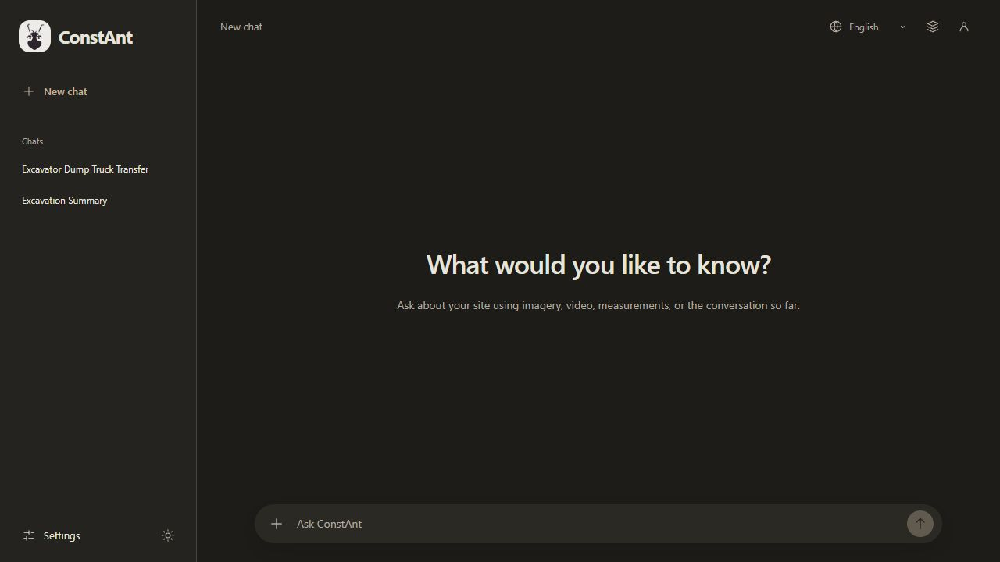
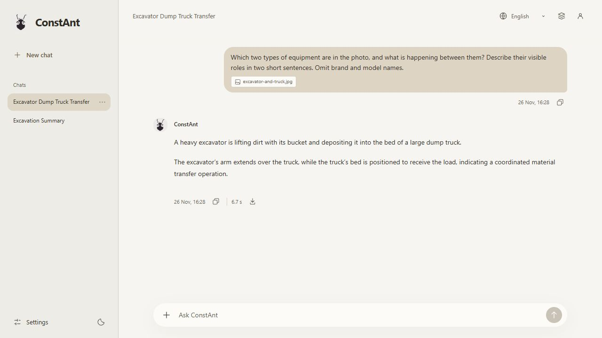
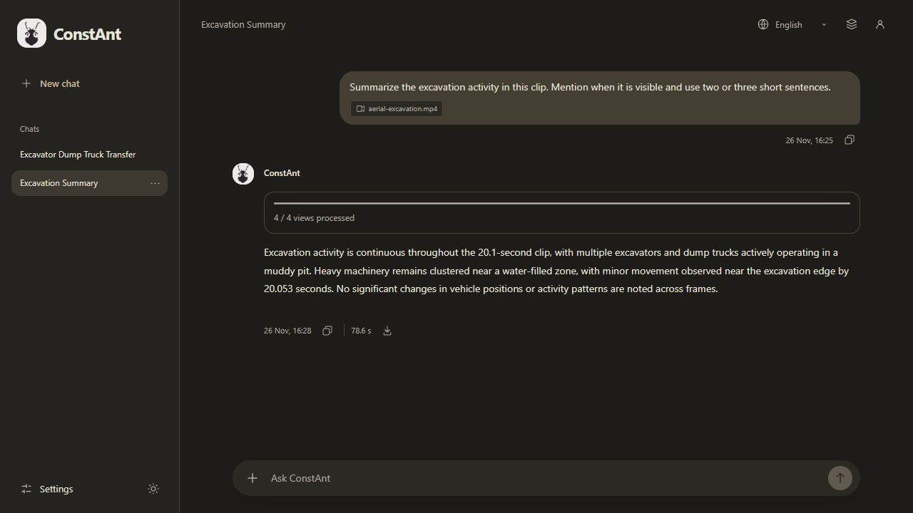

# ConstAnt

ConstAnt is a local assistant for exploring construction-site imagery, recordings, and particulate matter (PM) measurements. It uses Qwen3-VL-4B-Instruct for multimodal questions and Python for calculations on CSV data. The app combines a Vue 3 chat interface with a FastAPI backend.

## About the platform

| Input | How ConstAnt uses it |
| --- | --- |
| Site photos and orthophotos | Describe visible activity or estimate object counts. Large rasters are scanned in tiles with progress and cancellation. |
| Recorded video | Analyze timestamped frames sampled across the recording or a selected time range. |
| PM flight CSVs and other tables | Calculate filtered summaries, compare groups, and look up individual records. |
| Text and logs | Ask questions about the source contents and summarize findings. |

The chat sidebar keeps past conversations. Use **+** to upload a file or attach one from Resources. A follow-up can reuse evidence from the same chat. The interface supports English, Uzbek, and Korean.

### Default workspace

### Image query

### Video query

The image example uses a [National Park Service photo](https://commons.wikimedia.org/wiki/File:An_excavator_empties_its_bucket_into_a_waiting_dump_truck._%288f14fda3-31b2-4bc4-872d-dd0bfdcabc95%29.JPG). The video example uses [bellergy’s aerial footage](https://commons.wikimedia.org/wiki/File:Miejscu-pracy-koparka-budowlanych-3741.webm), released under [CC0](https://creativecommons.org/publicdomain/zero/1.0/).

## Run locally

The tested deployment uses Windows with Python 3.11, Node.js 24, and an NVIDIA Quadro RTX 5000 with 16 GB VRAM. The default inference engine, vLLM, runs in Ubuntu 24.04 under WSL 2.

From the project root, set up the Windows backend and build the frontend:

~~~powershell
py -3.11 -m venv .venv
.\.venv\Scripts\python.exe -m pip install -r backend\requirements.txt
cd frontend
npm ci
npm run build
cd ..
~~~

For a new WSL environment, follow the [vLLM setup instructions](docs/vllm.md#recreate-the-linux-environment). Once installed, start vLLM from the project root in one PowerShell terminal:

~~~powershell
.\scripts\start-vllm.ps1
~~~

Wait for startup to complete on port **8001**. In a second PowerShell terminal, from the project root, start the app:

~~~powershell
$env:CONST_VLM_ENGINE = 'vllm'
.\.venv\Scripts\python.exe -m uvicorn backend.main:app --host 127.0.0.1 --port 8000
~~~

Open [ConstAnt on localhost](http://127.0.0.1:8000). The model downloads on its first launch and is cached under `data/model-cache/`. The [deployment guide](docs/vllm.md) also covers the optional Windows Transformers engine, which uses NF4 by default.

For frontend development, keep FastAPI running and run `npm run dev` from `frontend/`. Vite serves the UI at `http://127.0.0.1:5173` and proxies API requests to port 8000.

## Project layout

| Path | Contents |
| --- | --- |
| `backend/` | FastAPI, model adapters, media processing, and CSV query execution |
| `frontend/` | Vue chat, resource previews, and interface tests |
| `scripts/` | vLLM startup, PM CSV import, and local dataset checks |
| `docs/` | Deployment and troubleshooting |
| [notes/](notes/README.md) | Experiment plans, reporting tools, and result templates |
| `data/` | Local uploads, chat records, model cache, and research backups |

The repository contains the application and experiment tooling. Uploads, saved conversations, model weights, and raw research runs stay in the local installation. Upload your own files to start. To import a directory of Sniffer4D flight CSVs with Speed, Alt, and trial in their filenames:

~~~powershell
.\.venv\Scripts\python.exe scripts\import_pm.py "C:\path\to\flight-csvs"
~~~

## Tests

Run the backend and frontend checks from the project root:

~~~powershell
.\.venv\Scripts\python.exe -m pip install -r backend\requirements-test.txt
.\.venv\Scripts\python.exe -m pytest backend\tests -q
cd frontend
npm test
npm run build
~~~

## Scope and limits

- Visual counts are estimates. Failed or stopped raster scans leave partial coverage, and sampled video can miss brief events.
- PM summaries describe uploaded measurements. Exposure or compliance conclusions require the applicable threshold, averaging period, and sampling context.
- Joblib and 3D geometry files can be stored for reference. The app does not execute uploaded models or calculate geometry measurements.
- The app is designed for a single local user and binds to loopback. It has no authentication for a public deployment.
- The [experiment plan](notes/experiment-plan.md) covers FAISS and PostgreSQL retrieval comparisons and a base-model versus QLoRA evaluation. These comparisons are planned research.
