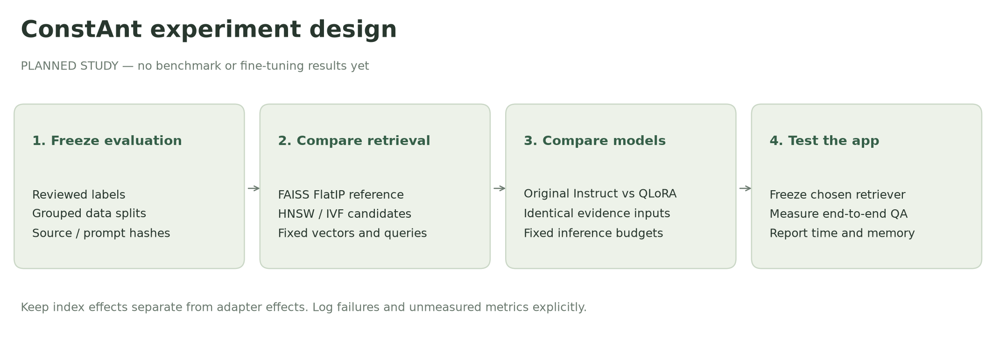

# ConstAnt experiment notes

This is the experiment record for **FAISS + PostgreSQL retrieval** and **unchanged Qwen3-VL-4B-Instruct versus QLoRA adapters**.

Status: historical baseline chats are archived; controlled comparisons are planned. No comparative index benchmark or QLoRA training has been run. Empty scored-result logs mean unmeasured, not zero performance. Earlier app smoke checks are engineering checks, not evaluation-set results.

The original local deployment retains its vLLM engineering validation report, raw outputs, and package versions under `reports/vllm-validation.*` and `reports/vllm-environment.txt`. The checks exercised integration on the RTX 5000. Controlled base-model, QLoRA, and index comparisons are tracked separately.

## Saved baseline results

Local reports under `baselines/<snapshot_id>/report.md` preserve prior analyses, along with questions and answers, model settings, observations, metrics, and charts. Model answers and counts remain unreviewed predictions.

Referenced originals are hash-verified copies in `data/experiments/baseline-objects`, deduplicated by content hash. This keeps large files outside `notes` and protects the comparison inputs if a live resource is deleted. The snapshot's `manifest.json` records each backup path/hash; `checksums.sha256` verifies the report, raw records and charts. Copy the snapshot and its referenced object storage together when moving the experiment.

To archive additional chats later, from the project directory:

```powershell
.\.venv\Scripts\python.exe -B notes\snapshot_baseline.py --data-dir data --notes-dir notes
```

Each invocation creates a new timestamped snapshot and never overwrites an older one. It does not run inference, train a model, change chat results, or fill the scored `results/models.csv`. Snapshots include a `cases.jsonl` manifest for a later paired comparison; reviewed reference answers and a common replay protocol are still needed. QLoRA work is deferred until discussed.

## Start here

1. Read [the experiment plan](experiment-plan.md) and freeze a reviewed evaluation set.
2. Copy [the run template](reports/run-template.md) into `reports/<run_id>.md` for each run. Record versions, configuration, split IDs, hashes, raw-output paths, and failures.
3. Append actual measurements to the CSVs in [results](results/README.md). Keep each `run_id` unique. Do not fill results from expectations or screenshots of unrelated runs.
4. Generate charts and the summary from the project directory:

```powershell
.\.venv\Scripts\python.exe -m pip install -r notes\requirements.txt
.\.venv\Scripts\python.exe -B notes\generate_report.py
```

The generator validates result logs, draws only measured results, and writes [the summary](reports/summary.md). It is a reporting tool: it does not build indexes, train adapters, run model evaluation, or automatically collect app jobs.

## Folder map

| Path | Contents |
| --- | --- |
| `experiment-plan.md` | Questions, controlled comparisons, evaluation protocol, and references |
| `baselines/<snapshot_id>/report.md` | Frozen baseline chat results, chart links and coverage limits |
| `baselines/<snapshot_id>/cases.jsonl` | Stable case IDs, frozen request/history and raw-result references |
| `snapshot_baseline.py` | Export existing baseline runs and back up referenced inputs without inference |
| `results/retrieval.csv` | Completed retrieval runs and optional planned/failed/skipped entries |
| `results/models.csv` | Baseline/QLoRA evaluation runs, one task and cohort per row |
| `results/training_steps.csv` | Real training/validation loss observations by step |
| `reports/run-template.md` | Reproducible run record to copy before each experiment |
| `reports/summary.md` | Generated tables and links to measured charts |
| `charts/experiment-design.png` and `.svg` | Planned study design, not performance results |
| `charts/retrieval-<cohort_id>.*` | Retrieval measurements when completed runs exist |
| `charts/models-<cohort_id>-<task>.*` | Model measurements when completed runs exist |
| `charts/training-<run_id>.*` | Training curves when real loss observations exist |

Charts export as PNG and SVG. Missing metrics are omitted rather than plotted as zero. Each point is one run; the generator does not pool different seeds, manufacture confidence intervals, or declare a winner. Existing charts from earlier cohorts are retained; the current summary links only the inputs used on that generation.



Original uploads stay in `data/assets`. Keep large files, vector indexes, model weights, and source-bearing reports in local storage.
