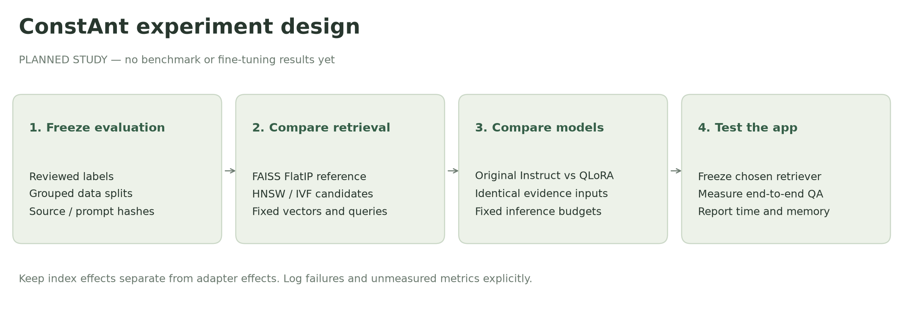

# Experiment comparison

Generated UTC: 2026-11-18T04:38:06+00:00

Inputs: `retrieval.csv`, `models.csv`, `training_steps.csv`. Only completed runs are compared; training curves use actual logged steps.

**No measured comparison results yet.** The design chart describes planned work; it is not a performance chart.

## Interpretation limits

Cohorts must have matching frozen manifests. This tool checks schema, numeric ranges, counts and selected cohort fields; it cannot verify source labels or reproduce a manually entered measurement.

Individual runs are not pooled into significance claims. Use the run reports and raw outputs for paired/source-group analysis. Measured retrieval fidelity does not establish answer accuracy, and a lower training loss does not establish a better construction assistant.
